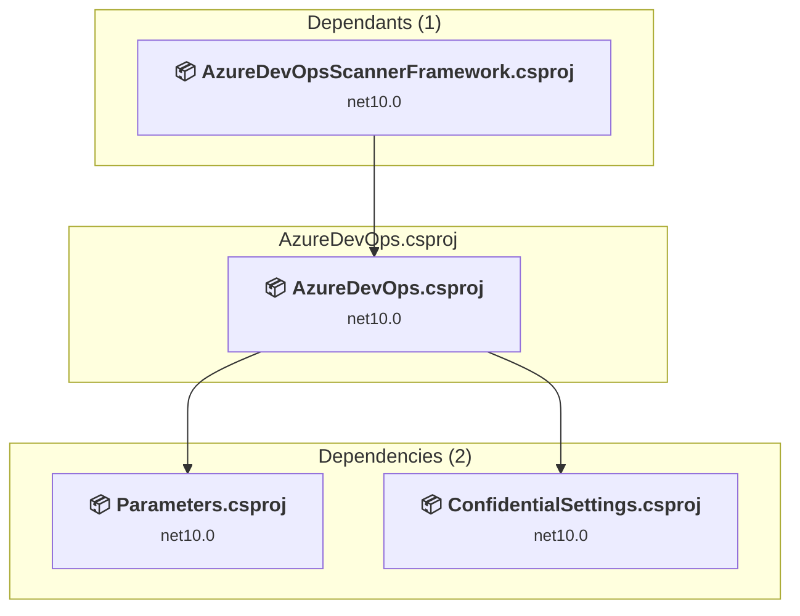

# AzureDevOps\AzureDevOps.csproj

[← Back to the assessment index](../../assessment.md)

## Project Info

- **Current Target Framework:** net10.0
- **Proposed Target Framework:** net11.0
- **SDK-style**: True
- **Project Kind:** ClassLibrary
- **Dependencies**: 2
- **Dependants**: 1
- **Number of Files**: 14
- **Number of Files with Incidents**: 2
- **Lines of Code**: 1958
- **Estimated LOC to modify**: 7+ (at least 0.4% of the project)

## Related Projects

**Depends on (2)** — projects this one references:

- [C:\repos\WorkSafeBC-Common-Engineering\AzureDevOps.Technology-Framework-Monitor\IT.TFM\ConfidentialSettings\ConfidentialSettings.csproj](../projects/ConfidentialSettings.md)
- [C:\repos\WorkSafeBC-Common-Engineering\AzureDevOps.Technology-Framework-Monitor\IT.TFM\ParameterSettings\Parameters.csproj](../projects/Parameters.md)

**Depended on by (1)** — projects that reference this one:

- [C:\repos\WorkSafeBC-Common-Engineering\AzureDevOps.Technology-Framework-Monitor\IT.TFM\AzureDevOpsScannerFramework\AzureDevOpsScannerFramework.csproj](../projects/AzureDevOpsScannerFramework.md)

## Dependency Graph

Legend:
📦 SDK-style project
⚙️ Classic project

## API Compatibility

| Category | Count | Impact |
| :--- | :---: | :--- |
| 🔴 Binary Incompatible | 0 | High - Require code changes |
| 🟡 Source Incompatible | 0 | Medium - Needs re-compilation and potential conflicting API error fixing |
| 🔵 Behavioral change | 7 | Low - Behavioral changes that may require testing at runtime |
| ✅ Compatible | 2874 |  |
| ***Total APIs Analyzed*** | ***2881*** |  |

