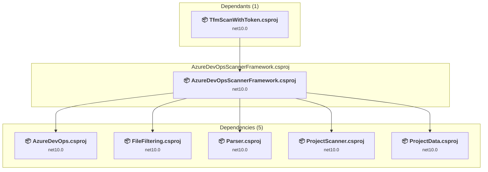

# AzureDevOpsScannerFramework\AzureDevOpsScannerFramework.csproj

[← Back to the assessment index](../../assessment.md)

## Project Info

- **Current Target Framework:** net10.0
- **Proposed Target Framework:** net11.0
- **SDK-style**: True
- **Project Kind:** ClassLibrary
- **Dependencies**: 5
- **Dependants**: 1
- **Number of Files**: 2
- **Number of Files with Incidents**: 2
- **Lines of Code**: 621
- **Estimated LOC to modify**: 2+ (at least 0.3% of the project)

## Related Projects

**Depends on (5)** — projects this one references:

- [C:\repos\WorkSafeBC-Common-Engineering\AzureDevOps.Technology-Framework-Monitor\IT.TFM\AzureDevOps\AzureDevOps.csproj](../projects/AzureDevOps.md)
- [C:\repos\WorkSafeBC-Common-Engineering\AzureDevOps.Technology-Framework-Monitor\IT.TFM\CodeFileFiltering\FileFiltering.csproj](../projects/FileFiltering.md)
- [C:\repos\WorkSafeBC-Common-Engineering\AzureDevOps.Technology-Framework-Monitor\IT.TFM\Parser\Parser.csproj](../projects/Parser.md)
- [C:\repos\WorkSafeBC-Common-Engineering\AzureDevOps.Technology-Framework-Monitor\IT.TFM\ProjectDataFramework\ProjectData.csproj](../projects/ProjectData.md)
- [C:\repos\WorkSafeBC-Common-Engineering\AzureDevOps.Technology-Framework-Monitor\IT.TFM\ProjectScannerFramework\ProjectScanner.csproj](../projects/ProjectScanner.md)

**Depended on by (1)** — projects that reference this one:

- [C:\repos\WorkSafeBC-Common-Engineering\AzureDevOps.Technology-Framework-Monitor\IT.TFM\TfmScanWithToken\TfmScanWithToken.csproj](../projects/TfmScanWithToken.md)

## Dependency Graph

Legend:
📦 SDK-style project
⚙️ Classic project

## API Compatibility

| Category | Count | Impact |
| :--- | :---: | :--- |
| 🔴 Binary Incompatible | 0 | High - Require code changes |
| 🟡 Source Incompatible | 2 | Medium - Needs re-compilation and potential conflicting API error fixing |
| 🔵 Behavioral change | 0 | Low - Behavioral changes that may require testing at runtime |
| ✅ Compatible | 611 |  |
| ***Total APIs Analyzed*** | ***613*** |  |

## NuGet Package Issues

| Package | Current Version | Suggested Version | Severity | Issue |
| :--- | :---: | :---: | :---: | :--- |
| System.Configuration.ConfigurationManager | 11.0.0 | 10.0.15 | 🟡 Potential | NuGet package upgrade is recommended |
| System.Runtime.Caching | 10.0.5 | 10.0.15 | 🟡 Potential | NuGet package upgrade is recommended |

Every project affected by these packages, and the versions the repository settles on: [aggregate NuGet packages](../nuget/aggregate-packages.md).

## Project Technologies and Features

| Technology | Issues | Percentage | Migration Path |
| :--- | :---: | :---: | :--- |
| Legacy Configuration System | 2 | 100.0% | Legacy XML-based configuration system (app.config/web.config) that has been replaced by a more flexible configuration model in .NET Core. The old system was rigid and XML-based. Migrate to Microsoft.Extensions.Configuration with JSON/environment variables; use System.Configuration.ConfigurationManager NuGet package as interim bridge if needed. |

