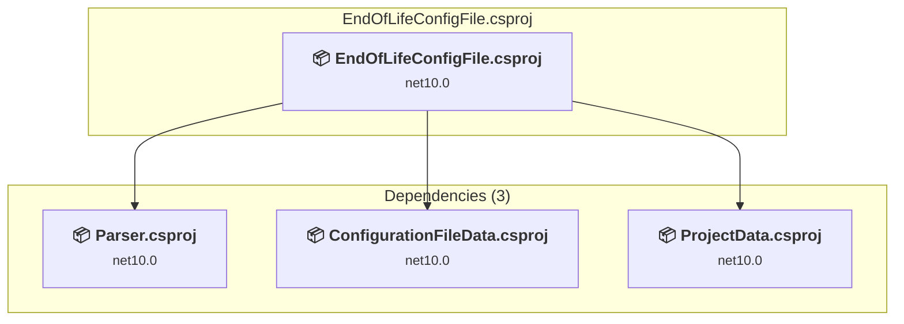

# EndOfLifeConfigFile\EndOfLifeConfigFile.csproj

[← Back to the assessment index](../../assessment.md)

## Project Info

- **Current Target Framework:** net10.0
- **Proposed Target Framework:** net11.0
- **SDK-style**: True
- **Project Kind:** ClassLibrary
- **Dependencies**: 3
- **Dependants**: 0
- **Number of Files**: 2
- **Number of Files with Incidents**: 1
- **Lines of Code**: 99
- **Estimated LOC to modify**: 0+ (at least 0.0% of the project)

## Related Projects

**Depends on (3)** — projects this one references:

- [C:\repos\WorkSafeBC-Common-Engineering\AzureDevOps.Technology-Framework-Monitor\IT.TFM\ConfigurationFileData\ConfigurationFileData.csproj](../projects/ConfigurationFileData.md)
- [C:\repos\WorkSafeBC-Common-Engineering\AzureDevOps.Technology-Framework-Monitor\IT.TFM\Parser\Parser.csproj](../projects/Parser.md)
- [C:\repos\WorkSafeBC-Common-Engineering\AzureDevOps.Technology-Framework-Monitor\IT.TFM\ProjectDataFramework\ProjectData.csproj](../projects/ProjectData.md)

## Dependency Graph

Legend:
📦 SDK-style project
⚙️ Classic project

## API Compatibility

| Category | Count | Impact |
| :--- | :---: | :--- |
| 🔴 Binary Incompatible | 0 | High - Require code changes |
| 🟡 Source Incompatible | 0 | Medium - Needs re-compilation and potential conflicting API error fixing |
| 🔵 Behavioral change | 0 | Low - Behavioral changes that may require testing at runtime |
| ✅ Compatible | 71 |  |
| ***Total APIs Analyzed*** | ***71*** |  |

