# ProjectDataFramework\ProjectData.csproj

[← Back to the assessment index](../../assessment.md)

## Project Info

- **Current Target Framework:** net10.0
- **Proposed Target Framework:** net11.0
- **SDK-style**: True
- **Project Kind:** ClassLibrary
- **Dependencies**: 0
- **Dependants**: 21
- **Number of Files**: 35
- **Number of Files with Incidents**: 4
- **Lines of Code**: 1199
- **Estimated LOC to modify**: 11+ (at least 0.9% of the project)

## Related Projects

**Depended on by (21)** — projects that reference this one:

- [C:\repos\WorkSafeBC-Common-Engineering\AzureDevOps.Technology-Framework-Monitor\IT.TFM\AzureDevOpsScannerFramework\AzureDevOpsScannerFramework.csproj](../projects/AzureDevOpsScannerFramework.md)
- [C:\repos\WorkSafeBC-Common-Engineering\AzureDevOps.Technology-Framework-Monitor\IT.TFM\CodeFileFiltering\FileFiltering.csproj](../projects/FileFiltering.md)
- [C:\repos\WorkSafeBC-Common-Engineering\AzureDevOps.Technology-Framework-Monitor\IT.TFM\ContentFilter\ContentFilter.csproj](../projects/ContentFilter.md)
- [C:\repos\WorkSafeBC-Common-Engineering\AzureDevOps.Technology-Framework-Monitor\IT.TFM\DataModels\RepoScan.DataModels.csproj](../projects/RepoScan.DataModels.md)
- [C:\repos\WorkSafeBC-Common-Engineering\AzureDevOps.Technology-Framework-Monitor\IT.TFM\DefaultMetricsScanner\DefaultMetricsScanner.csproj](../projects/DefaultMetricsScanner.md)
- [C:\repos\WorkSafeBC-Common-Engineering\AzureDevOps.Technology-Framework-Monitor\IT.TFM\EndOfLifeConfigFile\EndOfLifeConfigFile.csproj](../projects/EndOfLifeConfigFile.md)
- [C:\repos\WorkSafeBC-Common-Engineering\AzureDevOps.Technology-Framework-Monitor\IT.TFM\FileLocator\RepoScan.FileLocator.csproj](../projects/RepoScan.FileLocator.md)
- [C:\repos\WorkSafeBC-Common-Engineering\AzureDevOps.Technology-Framework-Monitor\IT.TFM\FilterConfigurationFromConfigFile\FilterConfigurationFromConfigFile.csproj](../projects/FilterConfigurationFromConfigFile.md)
- [C:\repos\WorkSafeBC-Common-Engineering\AzureDevOps.Technology-Framework-Monitor\IT.TFM\NpmFileParser\NpmFileParser.csproj](../projects/NpmFileParser.md)
- [C:\repos\WorkSafeBC-Common-Engineering\AzureDevOps.Technology-Framework-Monitor\IT.TFM\NuGetFileParser\NuGetFileParser.csproj](../projects/NuGetFileParser.md)
- [C:\repos\WorkSafeBC-Common-Engineering\AzureDevOps.Technology-Framework-Monitor\IT.TFM\NuGetScanner\NuGetScanner.csproj](../projects/NuGetScanner.md)
- [C:\repos\WorkSafeBC-Common-Engineering\AzureDevOps.Technology-Framework-Monitor\IT.TFM\OpenSecretsDetection\OpenSecretsDetection.csproj](../projects/OpenSecretsDetection.md)
- [C:\repos\WorkSafeBC-Common-Engineering\AzureDevOps.Technology-Framework-Monitor\IT.TFM\Parser\Parser.csproj](../projects/Parser.md)
- [C:\repos\WorkSafeBC-Common-Engineering\AzureDevOps.Technology-Framework-Monitor\IT.TFM\ProjectScannerFramework\ProjectScanner.csproj](../projects/ProjectScanner.md)
- [C:\repos\WorkSafeBC-Common-Engineering\AzureDevOps.Technology-Framework-Monitor\IT.TFM\ProjectScannerSaveToSqlServer\ProjectScannerSaveToSqlServer.csproj](../projects/ProjectScannerSaveToSqlServer.md)
- [C:\repos\WorkSafeBC-Common-Engineering\AzureDevOps.Technology-Framework-Monitor\IT.TFM\PythonParser\PythonFileParser.csproj](../projects/PythonFileParser.md)
- [C:\repos\WorkSafeBC-Common-Engineering\AzureDevOps.Technology-Framework-Monitor\IT.TFM\RepoScan.Storage.SqlServer\RepoScan.Storage.SqlServer.csproj](../projects/RepoScan.Storage.SqlServer.md)
- [C:\repos\WorkSafeBC-Common-Engineering\AzureDevOps.Technology-Framework-Monitor\IT.TFM\RuntimeMetricsScanner\RuntimeMetricsScanner.csproj](../projects/RuntimeMetricsScanner.md)
- [C:\repos\WorkSafeBC-Common-Engineering\AzureDevOps.Technology-Framework-Monitor\IT.TFM\Storage\Storage.csproj](../projects/Storage.md)
- [C:\repos\WorkSafeBC-Common-Engineering\AzureDevOps.Technology-Framework-Monitor\IT.TFM\VisualStudioFileParser\VisualStudioFileParser.csproj](../projects/VisualStudioFileParser.md)
- [C:\repos\WorkSafeBC-Common-Engineering\AzureDevOps.Technology-Framework-Monitor\IT.TFM\VisualStudioMetricsScanner\VisualStudioMetricsScanner.csproj](../projects/VisualStudioMetricsScanner.md)

## Dependency Graph

Legend:
📦 SDK-style project
⚙️ Classic project

```mermaid
flowchart TB
    subgraph upstream["Dependants (21)"]
        P2["<b>📦&nbsp;ProjectScanner.csproj</b><br/><small>net10.0</small>"]
        P3["<b>📦&nbsp;AzureDevOpsScannerFramework.csproj</b><br/><small>net10.0</small>"]
        P4["<b>📦&nbsp;Parser.csproj</b><br/><small>net10.0</small>"]
        P5["<b>📦&nbsp;VisualStudioFileParser.csproj</b><br/><small>net10.0</small>"]
        P6["<b>📦&nbsp;NuGetFileParser.csproj</b><br/><small>net10.0</small>"]
        P8["<b>📦&nbsp;ProjectScannerSaveToSqlServer.csproj</b><br/><small>net10.0</small>"]
        P9["<b>📦&nbsp;Storage.csproj</b><br/><small>net10.0</small>"]
        P10["<b>📦&nbsp;EndOfLifeConfigFile.csproj</b><br/><small>net10.0</small>"]
        P11["<b>📦&nbsp;ContentFilter.csproj</b><br/><small>net10.0</small>"]
        P12["<b>📦&nbsp;FilterConfigurationFromConfigFile.csproj</b><br/><small>net10.0</small>"]
        P14["<b>📦&nbsp;FileFiltering.csproj</b><br/><small>net10.0</small>"]
        P15["<b>📦&nbsp;RepoScan.FileLocator.csproj</b><br/><small>net10.0</small>"]
        P16["<b>📦&nbsp;RepoScan.DataModels.csproj</b><br/><small>net10.0</small>"]
        P17["<b>📦&nbsp;RepoScan.Storage.SqlServer.csproj</b><br/><small>net10.0</small>"]
        P19["<b>📦&nbsp;OpenSecretsDetection.csproj</b><br/><small>net10.0</small>"]
        P20["<b>📦&nbsp;NpmFileParser.csproj</b><br/><small>net10.0</small>"]
        P26["<b>📦&nbsp;NuGetScanner.csproj</b><br/><small>net10.0</small>"]
        P28["<b>📦&nbsp;DefaultMetricsScanner.csproj</b><br/><small>net10.0</small>"]
        P29["<b>📦&nbsp;VisualStudioMetricsScanner.csproj</b><br/><small>net10.0</small>"]
        P30["<b>📦&nbsp;RuntimeMetricsScanner.csproj</b><br/><small>net10.0</small>"]
        P31["<b>📦&nbsp;PythonFileParser.csproj</b><br/><small>net10.0</small>"]
        click P2 "../projects/ProjectScanner.md"
        click P3 "../projects/AzureDevOpsScannerFramework.md"
        click P4 "../projects/Parser.md"
        click P5 "../projects/VisualStudioFileParser.md"
        click P6 "../projects/NuGetFileParser.md"
        click P8 "../projects/ProjectScannerSaveToSqlServer.md"
        click P9 "../projects/Storage.md"
        click P10 "../projects/EndOfLifeConfigFile.md"
        click P11 "../projects/ContentFilter.md"
        click P12 "../projects/FilterConfigurationFromConfigFile.md"
        click P14 "../projects/FileFiltering.md"
        click P15 "../projects/RepoScan.FileLocator.md"
        click P16 "../projects/RepoScan.DataModels.md"
        click P17 "../projects/RepoScan.Storage.SqlServer.md"
        click P19 "../projects/OpenSecretsDetection.md"
        click P20 "../projects/NpmFileParser.md"
        click P26 "../projects/NuGetScanner.md"
        click P28 "../projects/DefaultMetricsScanner.md"
        click P29 "../projects/VisualStudioMetricsScanner.md"
        click P30 "../projects/RuntimeMetricsScanner.md"
        click P31 "../projects/PythonFileParser.md"
    end
    subgraph current["ProjectData.csproj"]
        MAIN["<b>📦&nbsp;ProjectData.csproj</b><br/><small>net10.0</small>"]
        click MAIN "../projects/ProjectData.md"
    end
    P2 --> MAIN
    P3 --> MAIN
    P4 --> MAIN
    P5 --> MAIN
    P6 --> MAIN
    P8 --> MAIN
    P9 --> MAIN
    P10 --> MAIN
    P11 --> MAIN
    P12 --> MAIN
    P14 --> MAIN
    P15 --> MAIN
    P16 --> MAIN
    P17 --> MAIN
    P19 --> MAIN
    P20 --> MAIN
    P26 --> MAIN
    P28 --> MAIN
    P29 --> MAIN
    P30 --> MAIN
    P31 --> MAIN

```

## API Compatibility

| Category | Count | Impact |
| :--- | :---: | :--- |
| 🔴 Binary Incompatible | 0 | High - Require code changes |
| 🟡 Source Incompatible | 8 | Medium - Needs re-compilation and potential conflicting API error fixing |
| 🔵 Behavioral change | 3 | Low - Behavioral changes that may require testing at runtime |
| ✅ Compatible | 1038 |  |
| ***Total APIs Analyzed*** | ***1049*** |  |

## NuGet Package Issues

| Package | Current Version | Suggested Version | Severity | Issue |
| :--- | :---: | :---: | :---: | :--- |
| System.Configuration.ConfigurationManager | 11.0.0 | 10.0.15 | 🟡 Potential | NuGet package upgrade is recommended |

Every project affected by these packages, and the versions the repository settles on: [aggregate NuGet packages](../nuget/aggregate-packages.md).

## Project Technologies and Features

| Technology | Issues | Percentage | Migration Path |
| :--- | :---: | :---: | :--- |
| Legacy Configuration System | 8 | 72.7% | Legacy XML-based configuration system (app.config/web.config) that has been replaced by a more flexible configuration model in .NET Core. The old system was rigid and XML-based. Migrate to Microsoft.Extensions.Configuration with JSON/environment variables; use System.Configuration.ConfigurationManager NuGet package as interim bridge if needed. |

