# TfmScanWithToken\TfmScanWithToken.csproj

[← Back to the assessment index](../../assessment.md)

## Project Info

- **Current Target Framework:** net10.0
- **Proposed Target Framework:** net11.0
- **SDK-style**: True
- **Project Kind:** DotNetCoreApp
- **Dependencies**: 19
- **Dependants**: 0
- **Number of Files**: 2
- **Number of Files with Incidents**: 2
- **Lines of Code**: 263
- **Estimated LOC to modify**: 6+ (at least 2.3% of the project)

## Related Projects

**Depends on (19)** — projects this one references:

- [C:\repos\WorkSafeBC-Common-Engineering\AzureDevOps.Technology-Framework-Monitor\IT.TFM\AzureDevOpsScannerFramework\AzureDevOpsScannerFramework.csproj](../projects/AzureDevOpsScannerFramework.md)
- [C:\repos\WorkSafeBC-Common-Engineering\AzureDevOps.Technology-Framework-Monitor\IT.TFM\ContentFilter\ContentFilter.csproj](../projects/ContentFilter.md)
- [C:\repos\WorkSafeBC-Common-Engineering\AzureDevOps.Technology-Framework-Monitor\IT.TFM\DataModels\RepoScan.DataModels.csproj](../projects/RepoScan.DataModels.md)
- [C:\repos\WorkSafeBC-Common-Engineering\AzureDevOps.Technology-Framework-Monitor\IT.TFM\DefaultMetricsScanner\DefaultMetricsScanner.csproj](../projects/DefaultMetricsScanner.md)
- [C:\repos\WorkSafeBC-Common-Engineering\AzureDevOps.Technology-Framework-Monitor\IT.TFM\FileLocator\RepoScan.FileLocator.csproj](../projects/RepoScan.FileLocator.md)
- [C:\repos\WorkSafeBC-Common-Engineering\AzureDevOps.Technology-Framework-Monitor\IT.TFM\FilterConfigurationFromConfigFile\FilterConfigurationFromConfigFile.csproj](../projects/FilterConfigurationFromConfigFile.md)
- [C:\repos\WorkSafeBC-Common-Engineering\AzureDevOps.Technology-Framework-Monitor\IT.TFM\NpmFileParser\NpmFileParser.csproj](../projects/NpmFileParser.md)
- [C:\repos\WorkSafeBC-Common-Engineering\AzureDevOps.Technology-Framework-Monitor\IT.TFM\NuGetFileParser\NuGetFileParser.csproj](../projects/NuGetFileParser.md)
- [C:\repos\WorkSafeBC-Common-Engineering\AzureDevOps.Technology-Framework-Monitor\IT.TFM\NuGetScanner\NuGetScanner.csproj](../projects/NuGetScanner.md)
- [C:\repos\WorkSafeBC-Common-Engineering\AzureDevOps.Technology-Framework-Monitor\IT.TFM\OpenSecretsDetection\OpenSecretsDetection.csproj](../projects/OpenSecretsDetection.md)
- [C:\repos\WorkSafeBC-Common-Engineering\AzureDevOps.Technology-Framework-Monitor\IT.TFM\ParameterSettings\Parameters.csproj](../projects/Parameters.md)
- [C:\repos\WorkSafeBC-Common-Engineering\AzureDevOps.Technology-Framework-Monitor\IT.TFM\ProjectScannerSaveToSqlServer\ProjectScannerSaveToSqlServer.csproj](../projects/ProjectScannerSaveToSqlServer.md)
- [C:\repos\WorkSafeBC-Common-Engineering\AzureDevOps.Technology-Framework-Monitor\IT.TFM\PythonParser\PythonFileParser.csproj](../projects/PythonFileParser.md)
- [C:\repos\WorkSafeBC-Common-Engineering\AzureDevOps.Technology-Framework-Monitor\IT.TFM\ReportsRefresh\ReportsRefresh.csproj](../projects/ReportsRefresh.md)
- [C:\repos\WorkSafeBC-Common-Engineering\AzureDevOps.Technology-Framework-Monitor\IT.TFM\RepoScan.Storage.SqlServer\RepoScan.Storage.SqlServer.csproj](../projects/RepoScan.Storage.SqlServer.md)
- [C:\repos\WorkSafeBC-Common-Engineering\AzureDevOps.Technology-Framework-Monitor\IT.TFM\RuntimeMetricsScanner\RuntimeMetricsScanner.csproj](../projects/RuntimeMetricsScanner.md)
- [C:\repos\WorkSafeBC-Common-Engineering\AzureDevOps.Technology-Framework-Monitor\IT.TFM\VisualStudioFileParser\VisualStudioFileParser.csproj](../projects/VisualStudioFileParser.md)
- [C:\repos\WorkSafeBC-Common-Engineering\AzureDevOps.Technology-Framework-Monitor\IT.TFM\VisualStudioMetricsScanner\VisualStudioMetricsScanner.csproj](../projects/VisualStudioMetricsScanner.md)
- [C:\repos\WorkSafeBC-Common-Engineering\AzureDevOps.Technology-Framework-Monitor\IT.TFM\YamlFileParser\YamlFileParser.csproj](../projects/YamlFileParser.md)

## Dependency Graph

Legend:
📦 SDK-style project
⚙️ Classic project

```mermaid
flowchart TB
    subgraph current["TfmScanWithToken.csproj"]
        MAIN["<b>📦&nbsp;TfmScanWithToken.csproj</b><br/><small>net10.0</small>"]
        click MAIN "../projects/TfmScanWithToken.md"
    end
    subgraph downstream["Dependencies (19)"]
        P20["<b>📦&nbsp;NpmFileParser.csproj</b><br/><small>net10.0</small>"]
        P26["<b>📦&nbsp;NuGetScanner.csproj</b><br/><small>net10.0</small>"]
        P5["<b>📦&nbsp;VisualStudioFileParser.csproj</b><br/><small>net10.0</small>"]
        P16["<b>📦&nbsp;RepoScan.DataModels.csproj</b><br/><small>net10.0</small>"]
        P29["<b>📦&nbsp;VisualStudioMetricsScanner.csproj</b><br/><small>net10.0</small>"]
        P19["<b>📦&nbsp;OpenSecretsDetection.csproj</b><br/><small>net10.0</small>"]
        P17["<b>📦&nbsp;RepoScan.Storage.SqlServer.csproj</b><br/><small>net10.0</small>"]
        P31["<b>📦&nbsp;PythonFileParser.csproj</b><br/><small>net10.0</small>"]
        P15["<b>📦&nbsp;RepoScan.FileLocator.csproj</b><br/><small>net10.0</small>"]
        P6["<b>📦&nbsp;NuGetFileParser.csproj</b><br/><small>net10.0</small>"]
        P8["<b>📦&nbsp;ProjectScannerSaveToSqlServer.csproj</b><br/><small>net10.0</small>"]
        P24["<b>📦&nbsp;YamlFileParser.csproj</b><br/><small>net10.0</small>"]
        P30["<b>📦&nbsp;RuntimeMetricsScanner.csproj</b><br/><small>net10.0</small>"]
        P12["<b>📦&nbsp;FilterConfigurationFromConfigFile.csproj</b><br/><small>net10.0</small>"]
        P28["<b>📦&nbsp;DefaultMetricsScanner.csproj</b><br/><small>net10.0</small>"]
        P25["<b>📦&nbsp;Parameters.csproj</b><br/><small>net10.0</small>"]
        P11["<b>📦&nbsp;ContentFilter.csproj</b><br/><small>net10.0</small>"]
        P3["<b>📦&nbsp;AzureDevOpsScannerFramework.csproj</b><br/><small>net10.0</small>"]
        P23["<b>📦&nbsp;ReportsRefresh.csproj</b><br/><small>net10.0</small>"]
        click P20 "../projects/NpmFileParser.md"
        click P26 "../projects/NuGetScanner.md"
        click P5 "../projects/VisualStudioFileParser.md"
        click P16 "../projects/RepoScan.DataModels.md"
        click P29 "../projects/VisualStudioMetricsScanner.md"
        click P19 "../projects/OpenSecretsDetection.md"
        click P17 "../projects/RepoScan.Storage.SqlServer.md"
        click P31 "../projects/PythonFileParser.md"
        click P15 "../projects/RepoScan.FileLocator.md"
        click P6 "../projects/NuGetFileParser.md"
        click P8 "../projects/ProjectScannerSaveToSqlServer.md"
        click P24 "../projects/YamlFileParser.md"
        click P30 "../projects/RuntimeMetricsScanner.md"
        click P12 "../projects/FilterConfigurationFromConfigFile.md"
        click P28 "../projects/DefaultMetricsScanner.md"
        click P25 "../projects/Parameters.md"
        click P11 "../projects/ContentFilter.md"
        click P3 "../projects/AzureDevOpsScannerFramework.md"
        click P23 "../projects/ReportsRefresh.md"
    end
    MAIN --> P20
    MAIN --> P26
    MAIN --> P5
    MAIN --> P16
    MAIN --> P29
    MAIN --> P19
    MAIN --> P17
    MAIN --> P31
    MAIN --> P15
    MAIN --> P6
    MAIN --> P8
    MAIN --> P24
    MAIN --> P30
    MAIN --> P12
    MAIN --> P28
    MAIN --> P25
    MAIN --> P11
    MAIN --> P3
    MAIN --> P23

```

## API Compatibility

| Category | Count | Impact |
| :--- | :---: | :--- |
| 🔴 Binary Incompatible | 0 | High - Require code changes |
| 🟡 Source Incompatible | 6 | Medium - Needs re-compilation and potential conflicting API error fixing |
| 🔵 Behavioral change | 0 | Low - Behavioral changes that may require testing at runtime |
| ✅ Compatible | 235 |  |
| ***Total APIs Analyzed*** | ***241*** |  |

## NuGet Package Issues

| Package | Current Version | Suggested Version | Severity | Issue |
| :--- | :---: | :---: | :---: | :--- |
| Microsoft.Extensions.Caching.Memory | 11.0.0 | 10.0.15 | 🟡 Potential | NuGet package upgrade is recommended |
| System.Configuration.ConfigurationManager | 11.0.0 | 10.0.15 | 🟡 Potential | NuGet package upgrade is recommended |

Every project affected by these packages, and the versions the repository settles on: [aggregate NuGet packages](../nuget/aggregate-packages.md).

## Project Technologies and Features

| Technology | Issues | Percentage | Migration Path |
| :--- | :---: | :---: | :--- |
| Legacy Configuration System | 6 | 100.0% | Legacy XML-based configuration system (app.config/web.config) that has been replaced by a more flexible configuration model in .NET Core. The old system was rigid and XML-based. Migrate to Microsoft.Extensions.Configuration with JSON/environment variables; use System.Configuration.ConfigurationManager NuGet package as interim bridge if needed. |

